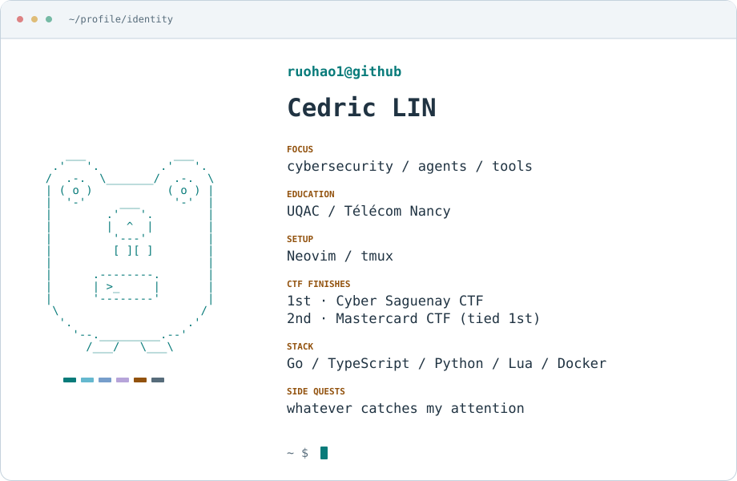

<picture>
  <source media="(max-width: 600px) and (prefers-color-scheme: dark)" srcset="assets/profile-terminal-compact-dark.svg">
  <source media="(max-width: 600px)" srcset="assets/profile-terminal-compact-light.svg">
  <source media="(prefers-color-scheme: dark)" srcset="assets/profile-terminal-dark.svg">
  
</picture>

[website](https://ruohao.dev) · [writeups](https://writeups.ruohao.dev)
